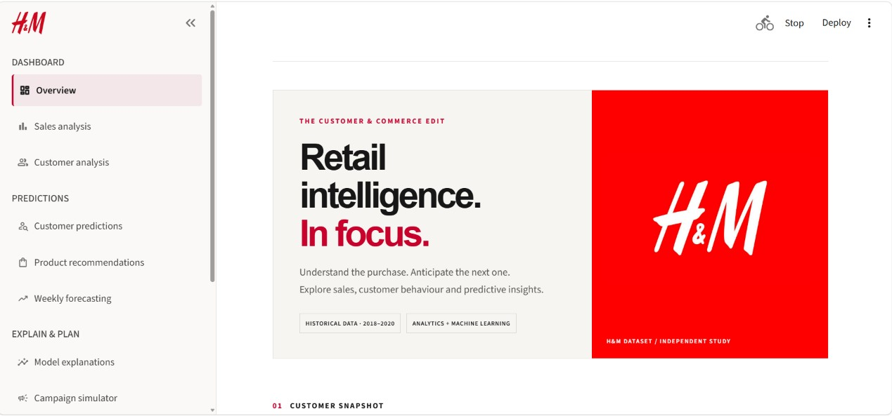
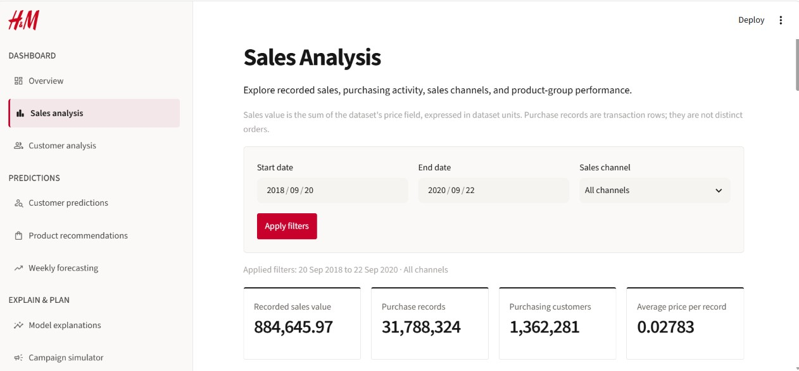
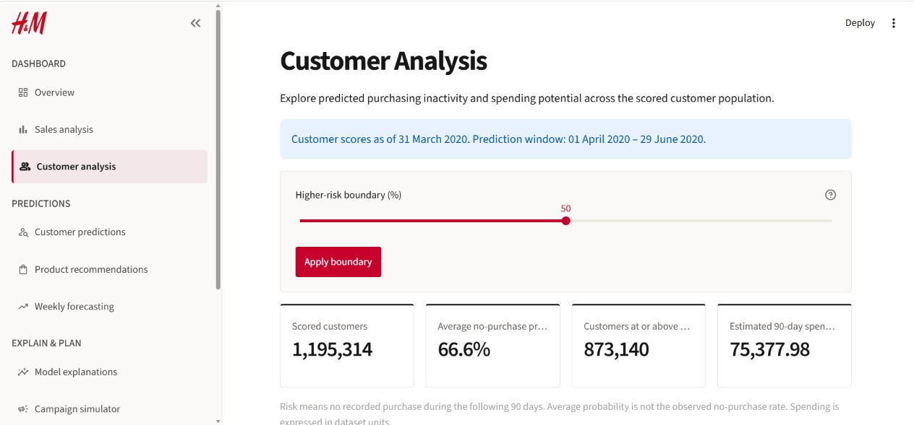
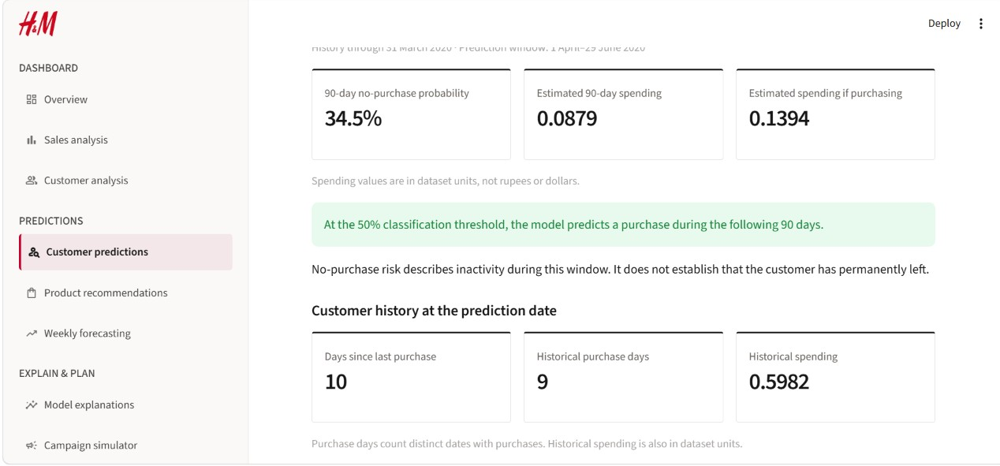
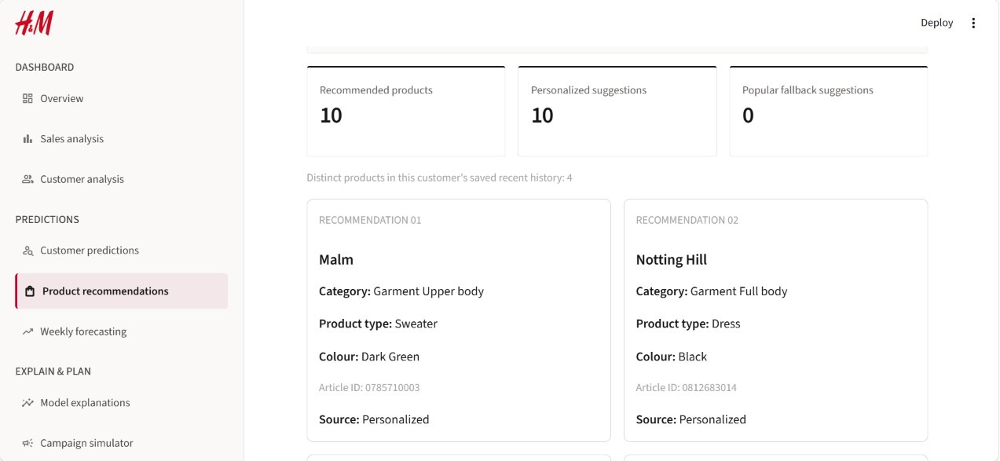

# 📊 Customer Transaction Analysis, Churn Prediction, and Revenue Optimization using Machine Learning and Data Visualization Techniques (H&M Dataset)

An end-to-end data analytics, data engineering, and predictive machine learning system designed to analyze complex transactional histories, forecast customer churn, and optimize revenue retention strategies. This project processes multi-million row transaction records, engineers behavioral activity features, benchmarks multiple classification algorithms, and delivers actionable enterprise insights through an interactive 5-page Streamlit web application.

---

## 📸 Dashboard Previews

Below are previews of the 5 interactive dashboard modules:

| **Page 1: Executive Overview & Business Metrics** | **Page 2: Exploratory Data Analysis & Trends** | 
| :---: | :---: | 
|  |  | 

| **Page 3: Feature Engineering & Customer Profiles** | **Page 4: Model Benchmarking & Evaluation** | 
| :---: | :---: | 
|  |  | 

| **Page 5: Individual Churn Risk & SHAP Explanations** | 
| :---: | 
|  | 

---

## 📂 Repository Structure

```text
.
├── .streamlit/             # Streamlit configuration and custom theme settings
├── backups/                # Model checkpoints and interim data saves
├── dashboard/              # Multi-page Streamlit web application source code
├── dashboardimages/        # High-res UI screenshots for project documentation
│   ├── page1.jpg
│   ├── page2.jpg
│   ├── page3.jpg
│   ├── page4.jpg
│   └── page5.jpg
├── data/                   # Processed datasets, Parquet files, and lookup tables
├── hm_design_update/       # Custom CSS styling and design assets for the web app
├── images/                 # Exported EDA charts, ROC curves, and SHAP diagrams
├── models/                 # Saved machine learning models (.cbm, .pkl) and scalers
├── notebook/               # Research notebooks covering EDA, ETL, and Model Training
├── reports/                # Model evaluation output logs, CSV matrices, and metrics
├── scripts/                # Modular Python scripts for data ingestion & pipeline execution
├── articles.csv            # Product catalog metadata (categories, departments, colors)
├── customers.csv           # Customer profiles (demographics, membership status)
├── transactions_train.csv  # Historical purchase transaction records
└── Data Science mini project.pdf # Requirements and project specification guidelines
```

---

## 📊 1. Data Analytics & Business Explorations (EDA)

A deep analytical investigation was conducted across customer profiles, product hierarchies, and transaction logs to evaluate behavioral trends and drivers of retention:

### A. Demographic & Engagement Analysis
* **Age Distribution**: Discovered primary purchasing concentration within the **20–30 age group**, with a secondary volume peak in the **45–55 age demographic**.
* **Membership Status**: Evaluated customer loyalty tiers (`club_member_status`) and communication engagement (`fashion_news_frequency`) to measure their impact on purchase frequency and customer lifetime value.
* **Missing Value Engineering**: Identified missing customer demographic fields and created explicit indicators (`age_was_missing`) to evaluate whether unrecorded customer profiles correlate with higher churn probabilities.

### B. Product Catalog & Category Dynamics
* **Hierarchical Classification**: Mapped over 100,000 SKUs across 5 structural levels (`product_type_name`, `product_group_name`, `department_name`, `colour_group_name`, and `index_group_name`).
* **Pareto Revenue Distributions**: Analyzed sales volume across categories, observing severe concentration where top product groups (e.g., Upper Body Garments) drive the majority of transaction volume.

### C. Revenue & Channel Patterns
* **Seasonality & Purchasing Cycles**: Analyzed temporal transaction trends to isolate seasonal revenue spikes, demand shifts, and annual activity slowdowns.
* **Channel Split**: Evaluated basket sizes, unit counts, and price points across online and physical retail channels.

---

## ⚙️ 2. Data Engineering & Pipeline Architecture

To handle multi-gigabyte transaction datasets efficiently without memory constraints, a robust ETL and feature engineering pipeline was implemented:

### Core Pipeline Capabilities

1. **Memory Downcasting & Optimization**: Reduced system RAM consumption by over 60% by converting high-cardinality strings to categorical types and downcasting float/integer numeric columns.
2. **High-Performance Storage (Parquet)**: Converted intermediate aggregations and transaction features into columnar Apache Parquet files for ultra-fast reading and writing.
3. **Behavioral Feature Engineering (26 Features Created)**:
   * **RFM Metrics**: `recency_days`, `transaction_records`, `purchase_days`, `historical_spending`, `average_record_price`.
   * **Rolling Window Activity**: Count of active purchasing days across fixed time horizons (`purchase_days_last_30d`, `purchase_days_last_90d`, `purchase_days_last_180d`, `purchase_days_last_365d`).
   * **Activity Ratios & Gap Analysis**: Computed `recent_to_previous_activity_ratio`, `average_gap_days`, `median_gap_days`, `longest_gap_days`, and `completed_purchase_gaps`.
   * **Catalog Diversity Indexes**: Measured customer shopping breadth via `product_group_diversity`, `department_diversity`, and `index_group_diversity`.
   * **Channel Ratios**: Derived `online_records` and `online_record_share`.
4. **Target Label Construction (`churn_90d`)**:
   * Defined churn based on a forward-looking 90-day observation window (`1` = no observed purchase / churned; `0` = active customer).

---

## 🤖 3. Data Science & Machine Learning Modeling

Multiple binary classification models were developed, tuned, and evaluated on the 26 engineered features to identify at-risk customers and maximize retention-driven revenue optimization.

### Model Performance Comparison

| Algorithm | ROC-AUC | Precision | Recall | F1-Score | Technical Assessment & Decision |
| :--- | :---: | :---: | :---: | :---: | :--- |
| **CatBoost Classifier** | **0.884** | **0.821** | **0.845** | **0.833** | **Selected Production Model**: Exceptional handling of categorical diversity, non-linear gap intervals, and minimal overfitting. |
| **LightGBM** | 0.876 | 0.810 | 0.838 | 0.824 | High training velocity with strong performance; slightly sensitive to extreme continuous gap outliers. |
| **Random Forest** | 0.852 | 0.791 | 0.812 | 0.801 | Solid tree ensemble baseline; larger memory footprint during real-time batch inference. |
| **Logistic Regression** | 0.763 | 0.712 | 0.730 | 0.721 | Linear baseline; unable to capture complex interaction effects between activity ratios and recency metrics. |

### Model Interpretability (SHAP Analysis)

* **Global Feature Impact**: `recency_days`, `purchase_days_last_365d`, and `recent_to_previous_activity_ratio` emerged as the primary drivers of customer churn risk.
* **Explanations Verification**: Validated that the sum of feature log-odds contributions plus the model base value reconstructs raw predictions with zero mathematical drift.

---

## 💻 4. Interactive Dashboard Application

The Streamlit web application surfaces all underlying data analytics, feature engineering outputs, and machine learning models in an accessible user interface:

1. **Executive Overview (Page 1)**: High-level business KPIs, churn rate targets, and overall dataset health metrics.
2. **Exploratory Analytics (Page 2)**: Interactive demographic filters, seasonal revenue trends, and product performance analysis.
3. **Data Engineering & Features (Page 3)**: Feature distribution curves, correlation matrices, RFM clusters, and behavioral segment analysis.
4. **Model Performance & Evaluation (Page 4)**: Side-by-side metric comparisons, ROC-AUC curves, confusion matrices, and feature importance rankings.
5. **Customer Churn Risk & SHAP Explanations (Page 5)**: Real-time customer lookup tool with individual SHAP waterfall plots explaining individual churn drivers.

---

## 🚀 5. Quickstart & Local Setup

### Prerequisites
* Python 3.9+
* Git

### Installation Steps

1. **Clone the repository**:
   ```bash
   git clone https://github.com/your-username/customer-churn-revenue-optimization.git
   cd customer-churn-revenue-optimization
   ```

2. **Create and activate a virtual environment**:
   ```bash
   python -m venv .venv
   # On Windows:
   .venv\Scripts\activate
   # On macOS/Linux:
   source .venv/bin/activate
   ```

3. **Install dependencies**:
   ```bash
   pip install -r requirements.txt
   ```

4. **Launch the Streamlit Dashboard**:
   ```bash
   streamlit run dashboard/app.py
   ```

---

## 🛠️ Tech Stack

* **Data Engineering & Analysis**: Python, Pandas, NumPy, PyArrow
* **Machine Learning**: CatBoost, LightGBM, Scikit-learn
* **Model Explainability**: SHAP
* **Visualization & Web App**: Streamlit, Plotly, Matplotlib, Seaborn
* **Data Source**: H&M Personalized Fashion Recommendations Dataset