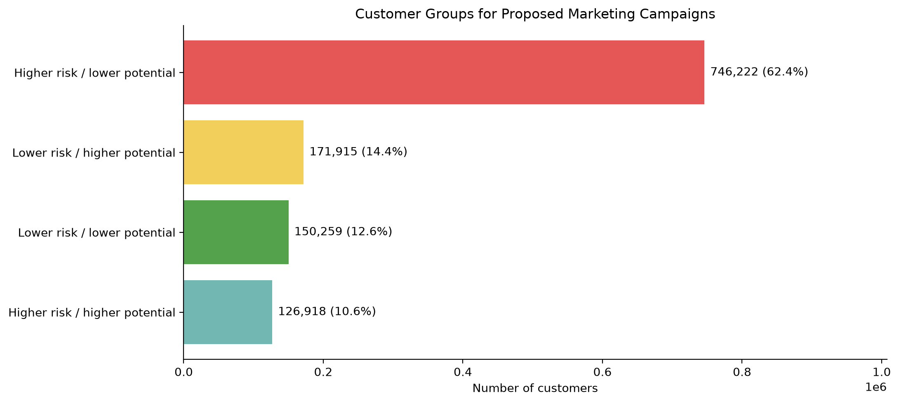

# Customer Transaction Analysis, Churn Prediction, and Revenue Optimization using Machine Learning and Data Visualization

## 1. Project objective

Analyze customer purchasing behavior, predict whether customers will make
no purchase during the next 90 days, estimate future customer spending,
and support customer prioritization for proposed marketing experiments.

The revenue optimization component provides decision support.
Realized revenue improvement has not been measured.

## 2. Dataset and preparation

The project uses the H&M transaction, customer, and article datasets:

- 31,788,324 purchase records.
- 1,371,980 customer records.
- 105,542 article records.
- Transaction coverage: 20 September 2018 to 22 September 2020.

DuckDB was used to process the data, and Parquet files were used for
storage. Customer-level datasets contain one row per customer.

The original modeling population contains 1,116,877 customers.
The enriched churn dataset contains 26 predictor columns.

## 3. Prediction definitions

### No-purchase prediction

- Class 0: at least one purchase in the following 90 days.
- Class 1: no purchase in the following 90 days.
- Decision threshold: 0.50.

This is a definition of observed inactivity, not proof of permanent churn.

### Future spending prediction

A two-stage model combines the probability of positive spending with
predicted spending conditional on purchasing.

The regressor was trained using a log1p transformation, and its
predictions are transformed back using expm1.

All spending values are expressed in scaled dataset units.
They are not confirmed currency amounts or profit.

## 4. Model development and validation

Classification candidates included Logistic Regression, Random Forest,
HistGradientBoosting, XGBoost, and CatBoost, alongside a majority-class
baseline.

Features describe historical activity, spending, channel use, recency,
purchase gaps, product diversity, and supplied customer age.

Training snapshot:
- Feature cutoff: 31 December 2019.
- Outcome window: 1 January to 30 March 2020.

Temporal validation snapshot:
- Feature cutoff: 31 March 2020.
- Outcome window: 1 April to 29 June 2020.
- Customers: 1,195,314.

The enriched feature comparison used the same training and test customers
for the baseline and enriched feature sets.

## 5. Selected churn model

Selected candidate: **CatBoost with enriched features**.

| Temporal validation metric | Result |
|---|---:|
| Accuracy | 76.37% |
| Precision for no purchase | 77.50% |
| Recall for no purchase | 88.71% |
| F1 for no purchase | 0.8273 |
| ROC AUC | 0.8198 |
| Average precision | 0.8763 |

The enriched boosting models performed similarly. CatBoost led narrowly
on several temporal validation metrics, but these small differences do
not establish a statistically significant advantage.

Average precision measures ranking performance and should not be
presented as classification accuracy.

## 6. Spending model results

These results were recalculated using the saved spending models and
exported predictions. Observed outcomes were joined by customer ID.

| Temporal validation metric | Result |
|---|---:|
| Actual total spending | 102,602.98 |
| Estimated total spending | 75,377.98 |
| Aggregate estimate error | -26.53% |
| MAE | 0.0786 |
| RMSE | 0.1744 |
| R² | 0.3313 |

The model underestimates aggregate spending. Its estimates require
further validation and calibration before use for financial planning.

## 7. Customer prioritization

Customers were segmented using predicted no-purchase risk and predicted
spending conditional on purchasing. Higher spending potential was
defined using the 75th percentile of the scored population.

| Customer segment | Customers | Share | Proposed action |
|---|---:|---:|---|
| Higher risk / lower potential | 746,222 | 62.4% | Test low-cost re-engagement |
| Lower risk / higher potential | 171,915 | 14.4% | Test loyalty and cross-sell campaigns |
| Lower risk / lower potential | 150,259 | 12.6% | Standard communication |
| Higher risk / higher potential | 126,918 | 10.6% | Test targeted retention offers |

These proposed actions are hypotheses for campaign experiments.
The model does not predict the causal effect of contacting a customer.

## 8. Limitations

- Temporal validation was repeatedly inspected during model selection;
  it is not an untouched final test.
- Customer age comes from supplied snapshot metadata. Its historical
  availability at the prediction cutoffs is unverified.
- Missing age was filled using the full customer snapshot median,
  rather than a median fitted only on training customers.
- Some engineered features are redundant with existing activity measures.
- Inverse-transforming log-scale predictions does not automatically
  recover conditional mean spending.
- The final spending model underestimates aggregate spending by
  26.53%.
- The earlier spending total could not be fully reconciled with the
  saved model state; this report uses the recomputed saved-model results.
- No campaign experiment, incremental revenue, or profit improvement
  has been observed.

## 9. Reproducibility and deliverables

Saved artifacts include:

- CatBoost churn model and metadata.
- Two-stage spending models and metadata.
- Historical and temporal enriched feature datasets.
- Customer training/test split manifest.
- Final customer scores and segment assignments.
- Temporal model comparison, segment summary, and visualization.

The model save/load checks confirmed that reloaded models reproduced
their predictions on the verification samples.

## 10. Recommended future work

- Evaluate the frozen pipeline on a later, untouched period.
- Use historically dated customer attributes where available.
- Fit preprocessing statistics only on training data.
- Investigate spending-model calibration using separate development data.
- Run a randomized campaign experiment to measure incremental revenue
  and campaign cost.
